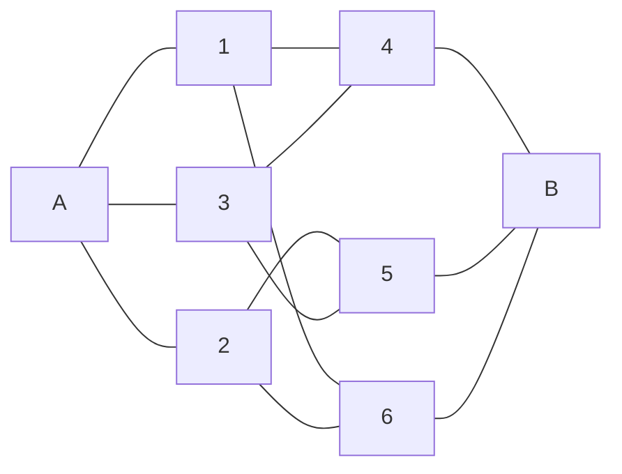

# P04 — Cube capacitor network from diagram caption

Local problem ID: `cube-capacitor-opposite-vertices` (no numeric source ID supplied).
Problem, diagram caption and source solution: [source.jsonl](source.jsonl).
[Physlib audit](PHYSLIB_AUDIT.md) · [Component classification](CLASSIFICATION.md).

## Diagram caption is part of the input

Unlike earlier demos, the input includes a **diagram caption** defining connectivity.
No original image was provided or visually reconstructed. The eight names and
all twelve undirected links are transcribed into `Problem.diagramEdges`:

```text
A–1, A–2, A–3,
1–4, 1–6, 2–5, 2–6, 3–4, 3–5,
4–B, 5–B, 6–B.
```

`Vertex.v1` through `v6` denote caption labels 1 through 6. A and B are the external
terminals. The orientation of pairs is bookkeeping; `Adj` inserts both directions.
All other pairs have zero coupling. Every listed edge has the same positive C.
`Verify.lean` checks 12 distinct edges and the caption's 3–6–3 layer counts.



This is a connectivity drawing, not a geometric rendering of the cube. The caption
is the sole source of connectivity in the trusted problem. Candidate residual
formulas are checked by expanding the generic charge sum over that edge list;
they are not a second unverified wiring specification.

## Physical model and units

Ideal linear capacitors, quasistatic equilibrium, initially uncharged isolated
internal conductors, no leakage and no stray capacitances. Potentials may have
any gauge offset or sign. Charge is signed. Interior node charge is zero:

```text
Qi = Σj Cij (Vi − Vj)
Qi = 0 for i ∉ {A,B}
```

The charge formula sums the familiar Q = C ΔV over the plates meeting at one
conductor. It is a supplied lumped electrostatic constitutive model, not a
Maxwell or circuit-current theorem. Neutrality is an explicit physical condition;
**equipotential layers are never an input assumption**.

Reuse the existing Physlib-backed `Charge`, `Voltage` and `Capacitance` aliases
(C, V, F) from the generic capacitor module. No `PlaneCapacitor` gap or optional
breakdown specification is needed. Values are fixed coherent-SI coordinates with
dimension tags; no general unit-covariance theorem is claimed.

## Source solution and formal proof route

The source invokes cube symmetry, merges {1,2,3} and {4,5,6}, and obtains
3C, 6C, 3C in series:

```text
1/Ceq = 1/(3C) + 1/(6C) + 1/(3C) = 5/(6C)
Ceq = (6/5) C = 1.2 C.
```

The Lean proof does **not** assume that symmetry implies equipotential nodes.
It solves the six neutral-node equations from the caption. For example:

```text
3 V1 − VA − V4 − V6 = 0
3 V2 − VA − V5 − V6 = 0
3 V3 − VA − V4 − V5 = 0
3 V4 − V1 − V3 − VB = 0
3 V5 − V2 − V3 − VB = 0
3 V6 − V1 − V2 − VB = 0.
```

Because C > 0, the common capacitance factor cancels. Linear elimination gives:

```text
V1 = V2 = V3 = (3 VA + 2 VB)/5
V4 = V5 = V6 = (2 VA + 3 VB)/5.
```

Hence the source's equipotential statement is a **derived result**. The terminal
charge is then

```text
QA = C [(VA−V1) + (VA−V2) + (VA−V3)]
   = (6/5) C (VA−VB).
```

An explicit potential assignment proves existence for every pair of boundary
potentials. The universal charge law holds for every neutral-interior state,
not just this chosen assignment. Equal boundary potentials are allowed: the proof
does not divide by VA−VB. The implementation is a physically equivalent nodal
reformulation, not a formal graph-automorphism or graph-quotient proof and not a
literal invocation of reusable series/parallel reduction theorems.

## Trusted proposition and judgment

`CubeData` contains only C and C > 0. No layer equality or answer is trusted input.
The reusable `HasEquivalentCapacitance` requires:

1. For every a,b, some potential assignment has terminal values a,b and neutral interior.
2. For every neutral-interior assignment, QA = Ceq (VA−VB).

```lean
def TrustedPhysicsProblem (data : CubeData) : Prop :=
  (network data).HasEquivalentCapacitance Vertex.A Vertex.B (answer data)

Candidate.solution data : TrustedPhysicsProblem data
```

`answer data` is the claimed coordinate `(6/5) * data.C.val`, in farads. Its charge
law and solvability are proved; they are not stored as evidence fields.
`Verify.lean` also checks that `CubeData` is inhabited, avoiding inconsistent input
assumptions. The annotated proof repeats the checked derivation with explanatory
comments; the English comments themselves are not machine-verified.

## Run

```bash
lake build
python3 scripts/verify.py --list
python3 scripts/verify.py P04
# Descriptive ID also works:
python3 scripts/verify.py cube-capacitor-opposite-vertices
```

Mutation tests are deferred, using the existing explicit `SKIPPED` mechanism.
No dependency pins or previous demo APIs were changed.

## Verified results

- `lake build`: PASS (3186 jobs), with the existing module interoperability warnings.
- `scripts/verify.py --list`: P04 registered with its descriptive ID.
- P04: compilation, explicit pairing and annotated proof PASS; mutations SKIPPED.
- M00, P01 and P02: PASS, with their six existing mutations each.
- P03: PASS, with its existing mutation stage SKIPPED.
- `#print axioms Candidate.solution`: only `propext`, `Classical.choice`, `Quot.sound`.
- Diagram cardinality, 3–6–3 layer counts and positive-C input consistency: checked in `Verify.lean`.
- `git diff --check`: PASS. Dependency pins and existing demo files unchanged.

Validation reused the installed toolchain and local upstream caches; an independent
empty-cache installation was not tested.
