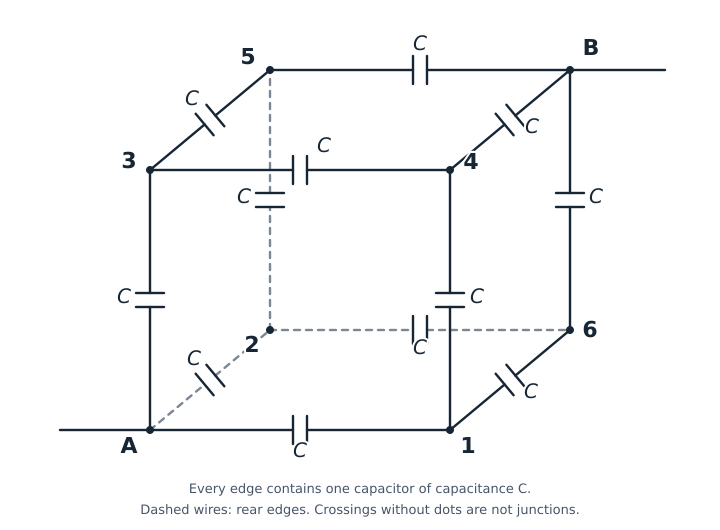

# P04 — Cube capacitor network from diagram caption

Source problem: **436** (Fig. 155). Local verification ID: `cube-capacitor-opposite-vertices`.
Problem, diagram caption and source solution: [source.jsonl](source.jsonl).
[Physlib audit](PHYSLIB_AUDIT.md) · [Component classification](CLASSIFICATION.md).

## Source question vs formalized question

### BEFORE — original source problem

> 436. Each edge of a cube made of wire contains a capacitor C (Fig. 155). Find the capacitance of this battery if it is connected to the circuit by means of conductors joined to the opposite apices A and B of the cube.

The original diagram supplies much of the circuit connectivity. The existing
caption and reconstructed problem SVG below preserve that diagram's provenance;
this comparison introduces no new caption or wiring interpretation.

### AFTER — Lean-facing formalized problem

For any `data : CubeData` (an edge capacitance `C` with `C > 0`), prove:

```lean
(network data).HasEquivalentCapacitance Vertex.A Vertex.B (answer data)
```

Here `(answer data).val = (6/5) * data.C.val`. The statement requires
nonnegative equivalent capacitance, a neutral-interior state for **every** pair
of terminal potentials, and `QA = (6/5) C (VA − VB)` for **every** neutral-interior
state. The candidate also proves that the answer is strictly positive.

### What changed

The diagram becomes the explicit eight-element `Vertex` type and twelve pairs
in `diagramEdges`. `Adj` makes these connections undirected; `network` assigns
capacitance C to each edge and zero to other pairs. A and B are explicit terminal
constructors; the edge topology represents their opposite-corner placement.
The already established provenance remains original scanned diagram → manually
transcribed factual caption → edge list → Lean network, with no claim that Lean
reads the scan itself.

Physlib supplies dimensional quantities, while PhyslibTemp supplies shared
capacitor aliases and the finite `CapacitorNetwork`, `nodeCharge`,
`NeutralInterior`, `DirichletState` and `HasEquivalentCapacitance` concepts.
The eight labels, twelve connections and identical positive edge C are P04 data.
Initially neutral isolated internal conductors and ideal linear couplings make
explicit the lumped-electrostatic assumptions behind the textbook network.

The candidate derives the six internal potentials and their equipotential
grouping from nodal charge balance, rather than trusting the source solution's
symmetry reduction. It constructs a state for arbitrary boundary potentials and
proves the terminal charge law, including equal terminal potentials without
dividing by their difference. This is **diagram-defined cube → explicit
capacitor-network topology**: the physical answer is preserved, its meaning is
made more explicit by solvability and a universal charge law, and the proof is
restructured from the printed series/parallel argument to nodal equations.


## Diagram caption is part of the input



*Problem figure reconstructed from the caption alone.* The cube projection is a
chosen layout, not a reproduction of the original scan. Dashed lines denote rear
wires only; crossings without a vertex dot are not connections. No solution-based
grouping or reduction is used in this figure.

Regenerate deterministically from the stored caption topology:

```bash
python3 LeanVerificationDemo/PhysicsDemo/P04/generate_problem_diagram.py
```

The generator reads only `diagram_caption` and `diagram_edges` in `source.jsonl`.
It places the labeled corners in a chosen affine cube projection and verifies
that their twelve cube edges match the caption exactly. Every edge has one
capacitor symbol and label C, and A/B have outward wire stubs. It does not read
the solution, Lean proof or any reduced circuit.

The original scanned problem diagram was provided by the user. Its factual
connectivity was manually transcribed into a **diagram caption**. Lean does not
use the image itself as trusted structured input. The provenance chain is:

```text
user-provided original scanned diagram
→ manually extracted factual caption
→ explicit edge list / topology
→ Lean formalization
```

The reconstructed SVG is generated from that caption-derived topology only,
without consulting solution facts. The eight names and all twelve undirected
links are transcribed into `Problem.diagramEdges`:

```text
A–1, A–2, A–3,
1–4, 1–6, 2–5, 2–6, 3–4, 3–5,
4–B, 5–B, 6–B.
```

`Vertex.v1` through `v6` denote caption labels 1 through 6. A and B are the external
terminals. The orientation of pairs is bookkeeping; `Adj` inserts both directions.
All other pairs have zero coupling. Every listed edge has the same positive C.
`Verify.lean` checks 12 distinct edges and the caption's 3–6–3 layer counts.

The caption is the sole source of connectivity in the trusted problem.
Candidate residual formulas are checked by expanding the generic charge sum over
that edge list; they are not a second unverified wiring specification.

## Physical model and units

Ideal linear capacitors, quasistatic equilibrium, initially uncharged isolated
internal conductors, no leakage and no stray capacitances. Potentials may have
any gauge offset or sign. Charge is signed. Interior node charge is zero:

```text
Qi = Σj Cij (Vi − Vj)
Qi = 0 for i ∉ {A,B}
```

The charge formula sums the familiar Q = C ΔV over the plates meeting at one
conductor. It is a supplied lumped electrostatic constitutive model, not a
Maxwell or circuit-current theorem. Neutrality is an explicit physical condition;
**equipotential layers are never an input assumption**.

Reuse the existing Physlib-backed `Charge`, `Voltage` and `Capacitance` aliases
(C, V, F) from `PhyslibTemp/Electromagnetism/CapacitorBasics.lean`. No `PlaneCapacitor` gap or optional
breakdown specification is needed. Values are fixed coherent-SI coordinates with
dimension tags; no general unit-covariance theorem is claimed.

## Source solution and formal proof route

The source invokes cube symmetry, merges {1,2,3} and {4,5,6}, and obtains
3C, 6C, 3C in series:

```text
1/Ceq = 1/(3C) + 1/(6C) + 1/(3C) = 5/(6C)
Ceq = (6/5) C = 1.2 C.
```

The Lean proof does **not** assume that symmetry implies equipotential nodes.
It solves the six neutral-node equations from the caption. For example:

```text
3 V1 − VA − V4 − V6 = 0
3 V2 − VA − V5 − V6 = 0
3 V3 − VA − V4 − V5 = 0
3 V4 − V1 − V3 − VB = 0
3 V5 − V2 − V3 − VB = 0
3 V6 − V1 − V2 − VB = 0.
```

Because C > 0, the common capacitance factor cancels. Linear elimination gives:

```text
V1 = V2 = V3 = (3 VA + 2 VB)/5
V4 = V5 = V6 = (2 VA + 3 VB)/5.
```

Hence the source's equipotential statement is a **derived result**. The terminal
charge is then

```text
QA = C [(VA−V1) + (VA−V2) + (VA−V3)]
   = (6/5) C (VA−VB).
```

An explicit potential assignment proves existence for every pair of boundary
potentials. The universal charge law holds for every neutral-interior state,
not just this chosen assignment. Equal boundary potentials are allowed: the proof
does not divide by VA−VB. The implementation is a physically equivalent nodal
reformulation, not a formal graph-automorphism or graph-quotient proof and not a
literal invocation of reusable series/parallel reduction theorems.

## Trusted proposition and judgment

`CubeData` contains only C and C > 0. No layer equality or answer is trusted input.
The reusable `HasEquivalentCapacitance` requires:

1. Ceq is nonnegative (`0 ≤ Ceq.val`).
2. For every a,b, some potential assignment has terminal values a,b and neutral interior.
3. For every neutral-interior assignment, QA = Ceq (VA−VB).

```lean
def TrustedPhysicsProblem (data : CubeData) : Prop :=
  (network data).HasEquivalentCapacitance Vertex.A Vertex.B (answer data)

Candidate.solution data : TrustedPhysicsProblem data
```

`answer data` is the claimed coordinate `(6/5) * data.C.val`, in farads. Its charge
law, nonnegativity and solvability are proved; they are not stored as evidence fields.
`Candidate.answer_pos` additionally proves `0 < (answer data).val` from C > 0.
`Verify.lean` also checks that `CubeData` is inhabited, avoiding inconsistent input
assumptions. The annotated proof repeats the checked derivation with explanatory
comments; the English comments themselves are not machine-verified.

## Run

```bash
lake build
python3 scripts/verify.py --list
python3 scripts/verify.py P04
# Descriptive ID also works:
python3 scripts/verify.py cube-capacitor-opposite-vertices
```

Mutation tests are deferred, using the existing explicit `SKIPPED` mechanism.
No dependency pins or previous demo APIs were changed.

## Verified results

- `lake build`: PASS (3187 jobs), with the existing module interoperability warnings.
- `scripts/verify.py --list`: P04 registered with its descriptive ID.
- P04: compilation, explicit pairing and annotated proof PASS; mutations SKIPPED.
- M00, P01 and P02: PASS, with their six existing mutations each.
- P03: PASS, with its existing mutation stage SKIPPED.
- `#print axioms Candidate.solution`: only `propext`, `Classical.choice`, `Quot.sound`.
- Diagram cardinality, 3–6–3 layer counts and positive-C input consistency: checked in `Verify.lean`.
- `git diff --check`: PASS. Dependency pins and existing demo files unchanged.

Validation reused the installed toolchain and local upstream caches; an independent
empty-cache installation was not tested.

## Shared module boundaries and API changes

```text
Physlib.Units.WithDim.Basic
└── CapacitorBasics (Charge, Voltage, Capacitance)
    ├── PlaneCapacitor (single uniform-gap capacitor physics)
    │   └── DielectricBreakdown (optional failure specification)
    └── CapacitorNetwork (finite coupling matrix and nodal electrostatics)
```

The network imports `CapacitorBasics` directly and has no dependency on plane
geometry or breakdown. `FieldMagnitude` and `Separation` remain in
`PlaneCapacitor`, since the network does not need them. P04 imports numerical
proof tactics explicitly rather than relying on the former plane-module import.

| Old declaration location/name | New location/name | Reason |
| --- | --- | --- |
| `PlaneCapacitor.lean`, `Charge` | `CapacitorBasics.lean`, same qualified name | Shared quantity, independent of geometry |
| `PlaneCapacitor.lean`, `Voltage` | `CapacitorBasics.lean`, same qualified name | Shared quantity, independent of geometry |
| `PlaneCapacitor.lean`, `Capacitance` | `CapacitorBasics.lean`, same qualified name | Shared quantity, independent of geometry |

All three retain namespace `LeanVerificationDemo.PhyslibTemp.Electromagnetism`.
No existing declarations were renamed. `HasEquivalentCapacitance` retains its
name but now explicitly includes nonnegativity as its first conjunct. This
formally strengthens `TrustedPhysicsProblem`; the nodal solvability/charge-law
clauses and physical answer 6C/5 are unchanged. The new `Candidate.answer_pos`
proves a source-specific stronger sign statement (also in the annotated replica).

Trusted input remains the problem statement, caption topology, identical edge C
and C > 0, with neutral internal conductors in the model. Equipotential grouping,
internal potentials and the terminal coefficient are derived in the candidate.
No series-capacitor API, parallel-reduction solver, additional circuit-graph
semantics or solution facts in the trusted premises were introduced.
