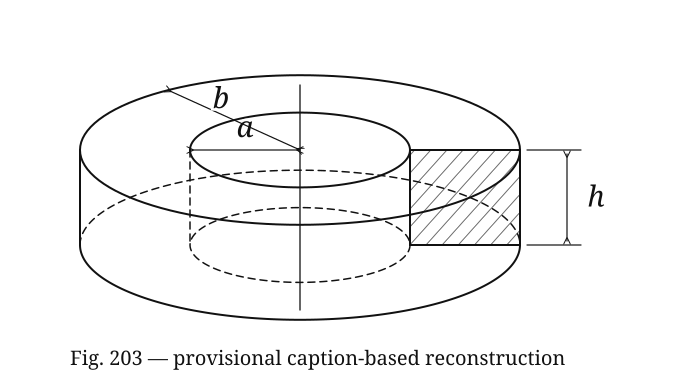

# P07 — Induced current in a ring of rectangular cross section

Source problem **574**, Fig. **203**. [Source record](source.jsonl) ·
[Physlib audit](PHYSLIB_AUDIT.md) · [Classification](CLASSIFICATION.md).

## Source question vs formalized question

### BEFORE — original source problem

> A ring of a rectangular cross section (Fig. 203) is made of a material whose resistivity is ρ. The ring is placed in a homogeneous magnetic field. The intensity of the magnetic field is directed along the axis of the ring and increases directly with time, H = kt. Find the intensity of the current induced in the ring.

The supplied solution divides the body into thin concentric rings of width δ,
uses `R = ρ (2πx)/(δ h)` and a flux-induced emf, sums their currents and takes
δ → 0. Its final answer is `I = 10^-8 (k h/(4ρ)) (b²−a²)`.

### AFTER — Lean-facing formalized problem

Given `data : RingData` and `response : Response data`, prove for every time t:

```lean
(totalCurrent data response t).val =
  sourceFactor * (data.k * data.h.val / (4 * data.ρ.val)) *
    (data.b.val ^ 2 - data.a.val ^ 2)
```

The parameter bundle contains dimension-tagged radii a,b, height h and resistivity
ρ, and a scalar field rate k, with `0 < a < b`, `h > 0`, `ρ > 0`, `k > 0`.
The field coordinate is defined as `H(t) = kt`; uniformity and axial direction
are encoded by using the same scalar field in every concentric disk's flux proxy
`π x² H(t)`. No spatial magnetic-vector field is constructed.

`Response` supplies an emf and a current contribution per radial width satisfying
the adopted Faraday and Ohm relations. The total is their radial integral, not
a final answer supplied as evidence. See the derivation below.

### What changed

The ring and figure become local geometric parameters and an independent-loop
continuum model. The printed discrete sum and limit are replaced by an integral;
the proof differentiates the prescribed flux proxy, derives the current density,
proves its integrability and evaluates its integral. This preserves the source
formula within its idealization, but restructures the proof analytically.
It does not formalize a discrete partition and its δ → 0 convergence, nor derive
all material/loop assumptions from Maxwell equations. The result is a current
magnitude in a prescribed-field resistive approximation, not the transient
solution of a self-inductive conductor or a proof of current direction.

## Figure and geometric provenance



Revised trusted geometry caption, supplied by the user:

> Figure 203 shows a short annular cylindrical body with a rectangular radial cross section, viewed in perspective about a vertical symmetry axis. The body has inner cylindrical radius a, outer cylindrical radius b, and axial height h. A radial cut on the right side exposes a vertical rectangular section extending from the inner cylindrical surface to the outer cylindrical surface through the full height h. The labels a and b denote distances from the central axis to the inner and outer cylindrical surfaces, respectively, and h denotes the vertical height of the exposed rectangular section.

The caption is trusted source/provenance input, not a cosmetic description.
It now specifies a short body and a right-side radial cut exposing the rectangle
from the inner to the outer cylindrical surface through the full height h.
The previous detached section view has been replaced by an exposed section on
the body itself. These are geometric details; the existing a,b,h parameters and
annular current model are unchanged.

Only the user-supplied Fig. 203 image and this agreed caption are authorized
sources. **The current illustration is not a caption-only reconstruction.**
During development, an independently located copy of the source figure was
inspected without authorization. The generator developed after that exposure
was subsequently modified; deleting the extracted image and changing the layout
did not establish independence from that visual reference. The drawing retains
that visual influence. The earlier claim that it was made solely from the
caption was incorrect.

That reference is not an accepted addition to the trusted source input. The
current SVG must not be used as evidence that the caption alone suffices to
reconstruct the source figure, or as an independent caption-to-image evaluation
result. No visual comparison with the authorized user-supplied image is claimed.
The SVG is a reconstructed illustration, not the original scan.

The trusted geometric facts remain those in the agreed caption. Manual
translation into Lean parameters is trusted preprocessing; Lean does not parse
the caption or infer parameters from pixels. This diagram revision changes no
Lean declarations or physical assumptions. Resistivity, the homogeneous axial
field and H = kt remain separate problem-text input, while Faraday/Ohm relations
and loop decomposition belong to the supplied solution and adopted model.

Regenerate with:

```bash
python3 LeanVerificationDemo/PhysicsDemo/P07/generate_problem_diagram.py
```

At execution time, the deterministic generator reads `diagram_caption` and
`diagram_geometry` from `source.jsonl`, and no image files. That runtime input
restriction does not establish that the generator's design was independent of
images: its fixed drawing instructions were developed after the visual exposure
described above.

## How the real-world ring is represented

There is no reusable ontology-level `Ring` object. `RingData` is a parameter
bundle; the annular geometry is represented collectively by a radial interval
[a,b], axial height h, circumference 2πx and disk area πx². `Response` and
`totalCurrent` supply the electrical part of this local model. The scalar
`currentPerWidth` is **dI/dx**, the contribution of concentric current loops per
radial width, not a current flowing radially and not Physlib's vector current
density J. Integrating it gives the azimuthal current crossing a radial section.

Assumptions are homogeneous constant resistivity, rectangular uniform height,
axisymmetry, independent concentric loops, and an externally prescribed field.
Self-inductance, magnetic feedback, skin effects and switch-on transients are
outside the model. Time is a source coordinate; the algebraic model is defined
for all real t, with the physical increasing-field scenario applicable for t ≥ 0.

## Historical H and the factor 10^-8

`sourceFactor : ℝ = 1/100000000` is an exact rational coordinate coefficient.
It is retained in both the local Faraday relation and the final result. The
provided material does not specify enough units to identify the historical H
with SI B, to choose a permeability, or to prove an SI conversion. No such
identification or conversion is made. The flux proxy `πx²H` is consequently a
source-coordinate quantity, not asserted to be SI magnetic flux in webers.

Length, resistivity and current reuse Physlib's `WithDim` dimension tags, but
numeric coordinates are in one **fixed source convention**, not silently in
metres, ohm-metres and amperes. The dimensional conversion between H, flux proxy,
emf and current is implicit in the adopted source-coordinate Faraday relation;
the real coefficient is not claimed to be a universal dimensionless constant.
Dimension tags on the parameters do not prove unit covariance of those scalar
relations. This is a faithful retention of the supplied answer's convention,
not a resolution of the missing historical unit specification.

## Physical relations and continuum derivation

For a thin loop of radius x and width δ, the source leading-order resistance is
`ρ 2πx/(δ h)`. Define the local resistance coefficient `r(x) = ρ 2πx/h`, so that
`Rδ ≈ r(x)/δ`. The approximation becomes exact at the level of the adopted
continuum coefficient; finite-width loop errors are not analyzed.

The evidence fields and derived steps are:

```text
H(t) = kt                              defined source field
Φproxy(x,t) = πx² H(t)                 adopted homogeneous axial flux proxy
emf(x,t) = 10^-8 dΦproxy/dt             supplied source-unit Faraday magnitude law
j(x,t) r(x) = emf(x,t)                 supplied continuum Ohm relation
→ dΦproxy/dt = πx² k                   proved by differentiation
→ j(x,t) = 10^-8 k h x/(2ρ)            derived using x > 0, h > 0, ρ > 0
I(t) = ∫[a,b] j(x,t) dx                adopted continuum summation
→ I(t) = 10^-8 (k h/(4ρ)) (b²−a²)      proved by integration
```

The positive orientation denotes current magnitude opposing increasing flux;
the signed minus in Lenz's law is not a separate target. The derived j is linear, so its integral is mathematically the Riemann-sum
limit of ideal strip contributions `j(x) δ`. This is the reason for the continuum
reformulation; the source itself used sums and a limit. We prove that the
integrand is integrable and evaluate the integral, but **do not prove** that
Riemann-sum convergence in Lean or control the errors of the printed finite-width
approximations. The continuum idealization and its physical validity remain
explicit modeling choices.

## Library boundary, trusted proposition and verification

Physlib supplies dimensional quantities. Its formal differential Faraday theorem
was audited, but no source-unit loop-emf/resistance bridge is available for direct
reuse. Mathlib supplies differentiation, integrability and interval integration.
**No PhyslibTemp concepts are added.** Geometry and scalar physical relations
remain P07-local; the source-specific unit factor is not exported.

The exact trusted proposition is `TrustedPhysicsProblem data response` as shown
above, universally quantified over t. The checked judgment is:

```lean
Candidate.solution data response : TrustedPhysicsProblem data response
```

`Verify.lean` constructs an inhabited parameter domain and a compatible emf/current
response for every `RingData`, without supplying a final total-current formula.
`CandidateAnnotated.lean` repeats the checked proof with explanatory comments;
`PairingWalkthrough.lean` prints its type and axioms. Mutation cases are deferred
with an explicit empty manifest, as in P03–P06.

```bash
lake build
python3 scripts/verify.py P07
```

## Validation results

- `lake build`: PASS (3637 jobs); existing module-interoperability warnings remain.
- P07, P06, P05, P04, P03, P02, P01 and M00 verification: PASS.
- P03–P07 mutation stages explicitly SKIPPED; M00/P01/P02 each passed 6/6 cases.
- Final theorem axioms: `[propext, Classical.choice, Quot.sound]`; no `sorry` or new axioms.
- Geometry-only trusted caption, deterministic SVG regeneration, valid SVG XML and rendered preview: checked. These checks do not establish caption-only provenance.
- `git diff --check`: PASS. Dependency pins and previous demo implementations unchanged.
