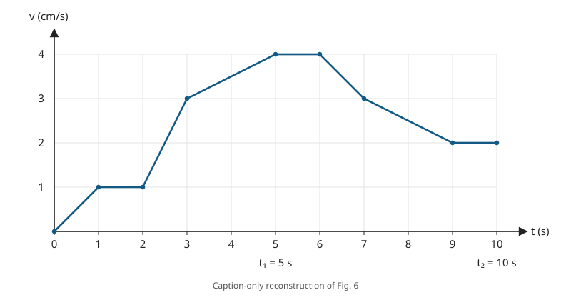

# P10 — Mean velocity and acceleration from a v–t graph

Source problem **23**. [Source pair](source.jsonl) ·
[Trusted caption](figure_caption.txt) · [Machine-readable geometry](figure_caption.json) ·
[Library audit](PHYSLIB_AUDIT.md) · [Classification](CLASSIFICATION.md).

## Source question vs formalized question

### BEFORE — original source problem

> Determine the mean velocity and the mean acceleration of a point in 5 and 10 seconds if it moves as shown in Fig. 6.

The supplied solution gives first-five and first-ten path lengths 10.5 cm and
25 cm, then the four averages. Those values are proof targets, never caption
facts or assumed areas.

### Caption-only problem graph



The trusted geometric input is exactly:

```text
Fig. 6 is a velocity–time graph.
Horizontal axis: time t, in seconds.
Vertical axis: velocity v, in cm/s.
Continuous straight-segment polyline through
(0,0), (1,1), (2,1), (3,3), (5,4), (6,4), (7,3), (9,2), (10,2).
Marked times: t₁ = 5 s and t₂ = 10 s.
```

The original Fig. 6 was supplied by the user in the surrounding workflow.
The P10 implementation itself was constructed from the user-approved trusted
caption rather than directly inspecting or parsing the source image. No claim
is made that the implementation agent independently verified the caption against
the image. `generate_problem_diagram.py` reads only
`figure_caption.json`; it does not read source solution text, Lean proofs,
images or an independently located source book. Axes layout, colors and grid
spacing are rendering choices. The SVG is a reconstruction, not a source scan.
No solution area, average, integration shading or extra curve is drawn.

### AFTER — Lean-facing formalized problem

Define the supplied polyline as a real velocity function `velocity t` in cm/s
over time in seconds. Integrate it over [0,5] and [0,10], divide displacement by
elapsed time, and compute mean acceleration as the endpoint velocity change
divided by elapsed time. Prove:

| Interval | Mean velocity | Mean acceleration |
| --- | --- | --- |
| first 5 s | 21/10 cm/s = 2.1 cm/s | 4/5 cm/s² = 0.8 cm/s² |
| first 10 s | 5/2 cm/s = 2.5 cm/s | 1/5 cm/s² = 0.2 cm/s² |

The exact checked judgment is `Candidate.solution : TrustedPhysicsProblem`:

```lean
meanVelocity 5 = 21 / 10 ∧ meanAcceleration 5 = 4 / 5 ∧
meanVelocity 10 = 5 / 2 ∧ meanAcceleration 10 = 1 / 5
```

### What changed

The diagram's coordinates, straight connections and units become explicit
input data. `time` and `ordinate` contain its nine vertices; `linearSegment`
interpolates consecutive points. A finite conditional definition selects the
correct segment. `velocity_at_vertices` and `velocity_on_segment` check all
vertices and every closed segment, including shared endpoint values.

The integral is the local kinematic representation of displacement when velocity
is supplied directly. It is not derived from a force law or reconstructed particle
trajectory. Mean velocity and acceleration are the standard definitions
`displacement T / T` and `(velocity T - velocity 0) / T`. Only positive times
5 and 10 are physical queries; real division at zero is not given a physical
interpretation. The velocity function's extension outside [0,10] is immaterial.

P10 therefore expands a diagram-dependent question into explicit graph data and
integral/endpoint calculations. It preserves the source's reasoning and does
not introduce masses, forces, a particle ontology or Newtonian dynamics.

## Actual proof dependency

`integral_linear_segment` proves the trapezoid formula from an explicit
antiderivative, interval integrability and Mathlib FTC:

```text
∫ from a to b [u + (w-u)/(b-a) · (t-a)] dt = (b-a)(u+w)/2.
```

The eight segment areas are derived in Candidate:

```text
[0,1]: 1/2     [1,2]: 1      [2,3]: 2      [3,5]: 7
[5,6]: 4       [6,7]: 7/2    [7,9]: 5      [9,10]: 2
```

Each segment is proved integrable. Mathlib's adjacent-interval theorem then
justifies adding the integrals, giving

```text
s₅ = 1/2 + 1 + 2 + 7 = 21/2 cm
s₁₀ = 21/2 + 4 + 7/2 + 5 + 2 = 25 cm.
```

`mean_velocity_five` and `mean_velocity_ten` divide these proven results by
5 and 10. `mean_acceleration_five` and `mean_acceleration_ten` use the proven
graph values v(0)=0, v(5)=4, v(10)=2. Thus the acceleration calculation needs no
derivative at the polyline's corners. Candidate.solution names all four final
claims before assembling them; CandidateAnnotated explains the same dependencies.

## Path travelled versus signed displacement

The local `pathTravelled T` is the integral of `|velocity t|`; `displacement T`
is the integral of `velocity t`. Candidate proves nonnegativity on [0,10], then
`path_eq_displacement` removes the absolute value on every [0,T] with 0 ≤ T ≤ 10.
This is particular to this graph. Verify includes a negative-velocity example
where path and signed displacement differ. No general arc-length theory or
unconditional path = displacement principle is assumed.

## Source-solution audit

| Ingredient | Status |
| --- | --- |
| Axis meanings/units, vertices, straight segments, marked times | Trusted supplied caption facts |
| Polyline function and interpolation | Local encoding, checked against all caption segments |
| Displacement = velocity integral | Explicit local kinematic definition for a given velocity graph |
| Path = displacement here | Derived using proved nonnegative velocity |
| Areas 10.5 cm and 25 cm | Derived by FTC and interval splitting; no source-area premise |
| Time-average velocity and endpoint-average acceleration | Local standard definitions, not reusable library additions |
| All four source averages | Derived exact rational targets |

The supplied solution's numerical claims are audited, not automatically trusted.
There are no SourceData premises or unknown trajectories; the input is a fixed,
explicit graph. No original-figure verification is implied by the successful Lean
proof: Lean checks consequences of the supplied caption interpretation.

## Small unit layer

`Units.lean` uses existing Physlib `WithDim`, `Dimension`, heterogeneous division
and proof-checked casts. It checks velocity × time = length, length/time =
velocity and velocity/time = acceleration. All four averages have the appropriate
typed dimensions. `graphUnits` changes upstream SI's length slot to
`LengthUnit.centimeters` and retains `TimeUnit.seconds`; `toDimensionful` records
the reported cm/s and cm/s² quantities. This is not a new unit framework and
does not import another problem's local aliases. No conversion to m/s is needed
for this source-native calculation.

P10 illustrates how physical dimensions transform through the source calculation:

```text
velocity × time → length          (cm/s) × s → cm
length / time → velocity          cm / s → cm/s
velocity / time → acceleration    (cm/s) / s → cm/s²
```

The graph supplies velocity as a function of time. Integrating it over time
produces displacement, a length quantity; dividing that displacement by elapsed
time gives mean velocity. Dividing the endpoint velocity change by elapsed time
gives mean acceleration. `P10/Units.lean` checks these dimension transformations
using upstream Physlib `WithDim` and certifies the source-native cm/s and cm/s²
interpretation of the reported values.

The main graph/integration proof remains scalar-valued, using exact real
coefficients. The interval integration is not performed directly inside
dimension-indexed `WithDim` quantities. The existing unit layer separately
certifies dimensions and the interpretation of those scalar results; dimensional
correctness does not replace the integral/endpoint derivation.
**No new PhyslibTemp module or declaration is added.**

## Verification

Verify checks the exact target, all nine vertices, straight interpolation on
all eight intervals, nonvertex samples, both path integrals and typed answers.
The generator is checked for deterministic output and agreement with caption
vertices; it also runs with only the geometry JSON available. The diagram has
been rendered and visually inspected. Mutation cases remain explicitly deferred.

```bash
python3 LeanVerificationDemo/PhysicsDemo/P10/generate_problem_diagram.py
lake build
python3 scripts/verify.py P10
lake env lean LeanVerificationDemo/PhysicsDemo/P10/Units.lean
git diff --check
```

Dependency pins and earlier demos remain unchanged.

### Validation results

- `lake build`: PASS (3662 jobs); existing module-interoperability warnings remain.
- M00 and P01–P10: all PASS. M00/P01/P02 mutations are 6/6 each; P03–P10
  remain explicitly SKIPPED.
- Direct `lake env lean` compilation of Units: PASS.
- Caption TXT/JSON, source record and Lean vertex arrays agree exactly; caption
  inputs exclude the source's solution values.
- SVG regeneration is deterministic, including an isolated run with only the
  generator and geometry JSON; nine vertex dots and one nine-point polyline checked.
- Reconstructed SVG rendered and visually inspected; the implementation agent
  does not claim independent verification of the caption against the source image.
- Candidate, CandidateAnnotated, path/displacement and typed-answer theorem axioms:
  `[propext, Classical.choice, Quot.sound]`; no `sorry` or new axioms.
- Metadata, documentation links, whitespace and `git diff --check`: PASS.
- PhyslibTemp, dependency pins and prior demo implementations: unchanged.
