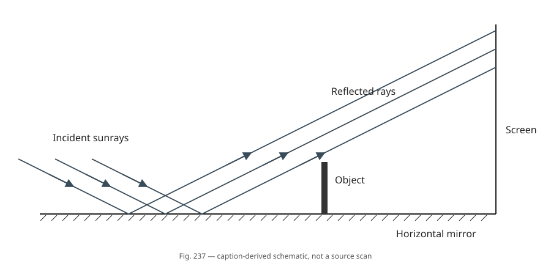

# P11 — Reflected ray geometry and shadow regimes

Source problem **677**. [Source pair](source.jsonl) ·
[Trusted Fig. 237 caption](figure_caption.txt) · [Audit](PHYSLIB_AUDIT.md) ·
[Classification](CLASSIFICATION.md).

## Source question vs formalized question

### BEFORE — original source problem

> Sunrays are reflected from a horizontal mirror and fall on a vertical screen. An oblong object is placed on the mirror (Fig. 237). Describe the shadow on the screen.

The original statement does **not** name h, l or α and does **not** state
`l ≥ h tan α`. The supplied solution introduces a quantitative description and
distinguishes regimes with and without that inequality. Its far-screen claim is
two adjoining portions called a “direct” (upright) and an inverted shadow,
with total length 2h; in the
near regime the shadow is shorter and has a portion illuminated by neither channel.

### Trusted source geometry and reference-only material

The trusted caption is limited to these qualitative Fig. 237 facts:

> A two-dimensional vertical cross-section contains a horizontal mirror along
> the bottom, a vertical screen on its right, and an upright oblong object on
> the mirror. The object is represented by a vertical segment with its lower
> endpoint on the mirror, between incoming rays and the screen. Parallel straight
> sunrays are incident obliquely downward onto the mirror; their reflections
> propagate toward the screen. The object lies horizontally between at least
> some incident/reflected ray paths and the screen.

The exact approved wording is in `figure_caption.txt` and the source record.
It contains no h/l/α labels, inequalities, shadow intervals or lengths. No
independent image/caption comparison is claimed. Fig. 494 is **solution-reference
material only**: no construction from it is parsed, encoded as caption data or
used as a premise. No independently located source book/image is consulted.




`problem_diagram.svg` is a caption-derived reconstruction of Fig. 237, not a
source scan and not a reconstruction from Fig. 494. The generator reads only
machine-readable caption geometry in [figure_caption.json](figure_caption.json).
It does not consume source solution text, Lean Candidate proofs, Fig. 494 or
solution-derived boundary information. The approved prose caption is unchanged.

Pixel positions, ray count, object drawing width and visual inclinations are
arbitrary rendering choices, not source measurements or formal h/l/α values.
The schematic illustrates the caption's qualitative placement. It labels no
shadow regime, contains no computed limiting rays and uses no solution diagram.
The image and these rendering choices are not additional trusted Lean premises.
Regenerate/check deterministically with:

```bash
python3 LeanVerificationDemo/PhysicsDemo/P11/generate_problem_diagram.py
python3 LeanVerificationDemo/PhysicsDemo/P11/generate_problem_diagram.py --check
```

### Terminology correction: orientation versus illumination channel

The **supplied solution** calls the two far-screen portions a “direct”
(upright) and an inverted shadow. In the formal model, **upright/inverted**
describes two orientations of reflected-light loss; **`directBlocked` is
reserved for actual blockage of the direct/unreflected sunlight channel**.
In particular, `uprightShadow` is not `directBlocked`.

This distinction is an audit result from solving the actual ray geometry.
For a strictly far screen, direct sunlight is unblocked, yet reflected light
has a shadow of length 2h. Obstruction before versus after reflection produces
the two reflected-light deficit portions. The source's contrast with doubly
illuminated regions is modeled as loss of at least one channel; full darkness
means loss of both.

**Source terminology ≠ formal physical-channel terminology.** Source wording
should not automatically determine Lean predicate names when the ray geometry
distinguishes different physical concepts.

### AFTER — Lean-facing formalized problem

For every positive object height h, positive screen distance l and acute
incidence angle α, derive the ray intersections and shadow sets in the ideal
parallel-ray mirror model. Prove both conditional conclusions:

```text
l ≥ h tan α → two reflected-channel shadow portions, each length h,
              bases meeting at one height, union length 2h

l < h tan α → shorter union, with a positive-length fully dark interval.
```

These case conditions are not stored as source evidence. The target is
`(FarScreen g → FarConclusion g) ∧ (NearScreen g → NearConclusion g)`;
`Candidate.solution g` proves it for every `Geometry g`. Verify supplies examples
of both regimes and the threshold, so the cases are not vacuous.

## Coordinate and angle convention

The following are formalization choices, not additional labels read from Fig. 237:

```text
mirror:       y = 0
opaque object: x = 0, 0 ≤ y ≤ h
screen:       x = l, y ≥ 0
α:            incidence angle from the vertical normal to the horizontal mirror, 0 < α < π/2
q = cot α = 1/tan α > 0
H = l q = l/tan α.
```

h/l/α and the coordinate origin parameterize the source's qualitative geometry;
the positivity/acute domains encode an upright object, right-hand screen and
oblique rays. They are not source-stated numerical facts or new empirical laws.
The physical idealization treats the segment as opaque, the mirror and screen
as extended, and ray availability as binary. Finite mirror edges, finite solar
disk, diffraction, penumbra and radiometric intensities are outside the model.

Incident direction is `(1,-q)`; reflection in the horizontal tangent gives
`(1,q)`. The directions are not normalized, which does not change their angles.
`incidence_ratio` proves that horizontal/normal magnitude ratio is tan α.
There is no switch to an angle measured from the surface.

The ray parameter t is **horizontal displacement, not time**. At mirror point r,
incident parameters t ≤ 0 describe the incoming half-ray, and reflected parameters
t ≥ 0 describe the outgoing half-ray. Outgoing obstruction is restricted to the
segment between reflection and screen. All positions use a common length unit.

## Deriving the geometry

`Problem.lean` imports the reusable
[PhyslibTemp reflection module](../../PhyslibTemp/Optics/Reflection.lean).
`mirror` specializes its `PlaneMirror` to a horizontal mirror with unit vertical
normal, and `reflectedDirection` calls `mirror.reflect`. The Candidate's
`reflection_geometry` applies `PlaneMirror2D.horizontal_reflect`, giving the
component flip `(1,-q) ↦ (1,q)` before any screen intersection is solved.

The reusable physical law models ideal specular reflection with Mathlib's
orthogonal reflection in the tangent hyperplane. It proves tangent preservation,
normal reversal, norm preservation, involution and equal normal-angle cosine
ratios. This is physical semantics over a mathematical primitive, not an optics
law supplied by Mathlib or a derivation from Maxwell equations.
[Design notes](../../PhyslibTemp/Optics/Reflection.md) and
[independent examples](../../PhyslibTemp/Optics/ReflectionExamples.lean) explain
and validate the layer without any P11 shadow assumptions.

For a mirror position r the Candidate derives:

```text
incident intersection with object axis:  (0, r q),       valid before mirror if r ≥ 0
outgoing intersection with object axis:  (0, -r q),      valid after mirror if r ≤ 0
screen intersection:                     (l, (l-r) q),   valid forward hit if r ≤ l.
```

Every nonnegative screen height z has exactly one reflected ray, with
`r = l - z/q`; no alternate unblocked reflected path is silently discarded.
For an object point at height u, these equations give the two screen maps
`H+u` (upright) and `H-u` (inverted). In particular the derived boundary heights
are H+h, H−h, with common object-base height H.

`boundary_ray_intersections` computes the top boundary rays. The top inverted
ray reflects at `r = h/q = h tan α`; its forward-screen condition is
`l-r ≥ 0`. Thus `top_boundary_screen_iff` derives exactly `l ≥ h tan α`.
Equivalently `threshold_characterization` proves

```text
H-h = 0 ↔ l = h tan α
h ≤ H   ↔ l ≥ h tan α
H < h   ↔ l < h tan α.
```

The far-screen proof actually uses the derived top-boundary hit. No threshold
inequality or boundary-height formula is a field of Geometry/source evidence.

## Exact sets and the two regimes

All intervals below are vertical screen heights. Candidate proves these identities
from ray/opaque-segment intersections, before doing interval arithmetic:

| Set | Exact result | Meaning |
| --- | --- | --- |
| `uprightShadow` | [H,H+h] | Reflected ray blocked after reflection |
| `invertedShadow` | [max(0,H−h),H] | Incoming ray blocked before its mirror reflection |
| `reflectedBlocked` | [max(0,H−h),H+h] | Union of those two losses |
| `directBlocked` | [0,h−H] | Unreflected sunlight intercepted on its way to the screen; empty if upper < 0 |
| `shadow` | [max(0,H−h),H+h] | At least one channel missing, relative to doubly illuminated screen |
| `fullyDark` | [0,h−H] | Neither direct nor reflected illumination |

`direct_subset_reflected` rules out a reflected-only region in this particular
geometry. `darkness_channels` proves the negative-illumination interpretation;
`reflected_availability` proves that absence of reflected blockage really means
an unobstructed member of the unique reflected-ray family exists.

For H ≥ h, the two portions are [H,H+h] and [H−h,H], meeting in `{H}`. Their
lengths are each h and their union has length 2h. `verticalLength` is the real
Lebesgue length of the actual set, not a stored endpoint answer.

For H < h, the inverted top boundary falls below the screen bottom. Clipping
gives a union [0,H+h] of length **H+h < 2h**. The fully dark interval [0,h−H]
has positive length h−H. These exact near-screen formulas are **derived
strengthenings**, not additional statements attributed to the printed solution.

For strict H > h, direct sunlight is available throughout the screen. At H = h
the inclusive opaque-contact convention can block the single base point 0;
that set has zero length. Closed boundary rays and inclusive contacts are modeling
conventions and do not change any length result.

## Source-solution audit and reuse

- **Source/figure facts:** horizontal mirror, vertical screen, upright segment,
  oblique parallel rays and relative placement, via the approved Fig. 237 caption.
- **Quantitative encoding:** h, l, α, q, H, coordinates, extended-surface/opaque-ray
  idealization. None of these symbols is claimed to be an original figure label.
- **Solution-introduced cases:** FarScreen/NearScreen, derived as boundary-ray
  ordering conditions and passed only to conditional result theorems.
- **Reusable physical law:** ideal specular plane-mirror semantics in PhyslibTemp.
- **Derived geometry:** reflection components, screen/object intersections,
  orientation maps, intervals, threshold and channel overlap.
- **Pure mathematics:** trigonometric positivity, affine algebra, interval sets
  and Lebesgue lengths.
- **Reference-only:** Fig. 494, with no role as a trusted input.

Pinned stable Physlib's Optics directory provides no applicable formal
plane-mirror law. Mathlib supplies orthogonal reflection; PhyslibTemp now supplies
its reusable ideal-specular physical interpretation and theorem surface. This
revises the earlier no-extension decision: a mathematical primitive alone does
not replace a reusable physics API. P11's ray obstruction, illumination channels,
thresholds and shadows remain problem-local. No new unit framework is added.
`Units.lean` uses upstream WithDim to check that h tan α and l both have length
dimension; the typed inequality is equivalent to the scalar case predicate,
not a new assumption that the inequality holds.

## Reviewer-facing dependency and verification

```text
Mathlib reflection → PhyslibTemp ideal specular mirror → P11 horizontal specialization
→ component/ray equations → object/screen intersections
→ upright/inverted intervals → physical top-boundary condition / threshold
→ channel sets and clipped union → interval lengths → both regime conclusions
```

Verify has far, near and critical geometries (test-only α=π/4), checks both
length regimes, a nonempty dark interval, and a far-screen point receiving
direct sunlight while reflection is blocked. No numeric test geometry is source
caption data. Mutations are explicitly deferred as in recent demos.

```bash
lake build
python3 scripts/verify.py P11
lake env lean LeanVerificationDemo/PhysicsDemo/P11/Units.lean
git diff --check
```

Validation: `lake build` passed (3670 jobs); M00 and P01–P11 all passed.
M00/P01/P02 passed all six mutation checks each; P03–P11 explicitly skipped
deferred empty mutation manifests. Direct compilation of `ReflectionExamples.lean`
and `Units.lean`, deterministic SVG regeneration (`--check`), generator input-file
audit and `git diff --check` passed. Both Candidate and CandidateAnnotated final theorems
use only `[propext, Classical.choice, Quot.sound]`; no `sorry` or new axiom
was introduced. Dependency pins and previous demos are unchanged. PhyslibTemp
now contains the independent reflection law and examples described above.
