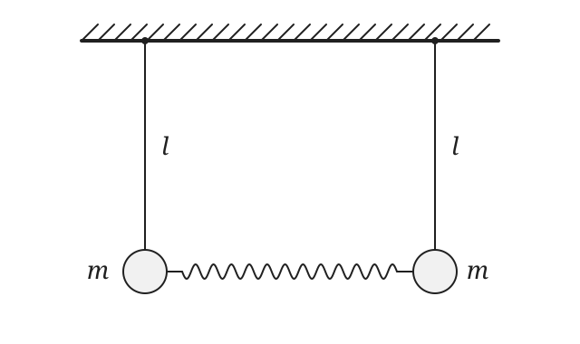

# P14 — Angular frequencies of spring-linked pendulums

Source problem **638**. [Source record](source.jsonl) ·
[Classification](CLASSIFICATION.md) · [Pinned-library audit](PHYSLIB_AUDIT.md).

## Source question vs formalized question

### BEFORE — original source problem

> Two mathematical pendulums each with a length l are connected by a weightless
> spring as shown in Fig. 228. The coefficient of elasticity of the spring is k.
> In equilibrium the pendulums occupy a vertical position and the spring is not
> deformed. Determine the frequencies of small oscillations of the two linked
> pendulums when they are deflected in one plane through equal angles in one
> direction (oscillations in phase) and in opposite directions (oscillations in
> antiphase).

### AFTER — Lean-facing formalized problem

Two equal-mass pendulums of length l are connected at their bobs by an unstretched
Hooke spring in vertical equilibrium. Given positive l, m, k and g, determine the
unique pair of positive angular frequencies for the in-phase and antiphase
motions in the equilibrium linearization of this ideal planar system.

`Problem.lean` contains source/model parameters, bob coordinates, upstream gravity
and Hooke force, torques, and the derivative-based small-oscillation model. Its
success criterion requires rotational Newton II for **both bobs** with harmonic
angular acceleration −ω² times angular displacement:

```lean
def IsModeFrequencySolution (data : CoupledPendulumData) (answer : ModeFrequencies) : Prop :=
  IsModeFrequency data .inPhase answer.inPhase ∧
  IsModeFrequency data .antiPhase answer.antiPhase

def TrustedPhysicsProblem (data : CoupledPendulumData) : Prop :=
  ∃! answer, IsModeFrequencySolution data answer
```

There is no square-root answer, solved mode stiffness, or expected frequency in
this target. Candidate constructs the pair, derives its validity and proves
uniqueness among positive frequencies. The four physical parameters are symbolic;
the source supplies no numerical values.

### What changed

The everyday apparatus is represented by local parameters and coordinates plus
the existing Physlib pendulum/oscillator laws. No reusable coupled-pendulum
ontology is introduced. Equal mass m is source information read **directly from
Fig. 228**, even though the prose does not name it. Positive gravity and a positive
pivot separation parameterize the physical/coordinate model. The source does not
label the separation; it drops out of the answer.

## Source-image reconstruction workflow

For problems whose geometry is communicated through a figure, the original
problem image itself should be inspected directly. P14 uses this workflow:

```text
original problem text
+
original problem image
→ direct multimodal interpretation
→ formal model
→ newly drawn source-faithful schematic
```

The schematic is drawn while visually referring to the original problem figure,
in the same image-referenced spirit as P07. It preserves only information in the
original statement and problem figure. Solution-only annotations, force diagrams,
derived quantities and formulas are excluded. P07's separately documented
provenance limitations remain part of its historical record.

The user identified `Pictures/Screenshots/Screenshot from 2026-11-04 15-00-14.png`.
That actual image was opened and inspected. It shows the original **Fig. 228**:
two distinct suspension points on a common fixed support, equal vertical links
marked l, two bobs each marked m, and a horizontal spring connecting the bobs.
The text supplies the additional fact that this equilibrium spring is unstretched.
The source record stores the image reference and SHA-256 for identification.



This SVG is a newly drawn visual restatement of the inspected source image,
not a source scan or crop. The [deterministic generator](generate_problem_diagram.py)
was authored from that direct analysis. It reads no caption file, solution text,
Candidate proof or Fig. 479. Pixel coordinates, coil count and glyph positions are
rendering choices. It depicts only the original equilibrium apparatus, with l and
m labels; no force arrows, displaced-mode construction or frequency formulas.

The reconstructed diagram therefore contains only:

- the two fixed suspension points;
- the two equal pendulums of length l;
- the two equal masses m;
- the spring connecting the two bobs;
- the vertical equilibrium configuration.

The original textbook scan is not copied into the repository. The clean new
schematic uses Fig. 228 directly as its visual reference.

```bash
python3 LeanVerificationDemo/PhysicsDemo/P14/generate_problem_diagram.py --check
```

Provenance observations in `source.jsonl` document what was read from the image;
they do not replace it with a manually curated trusted caption. There is no
`figure_caption.txt` or caption-to-model input stage in P14.

The task also describes **Fig. 479**, a solution-side force diagram. The supplied
file is Fig. 228 only; no separate Fig. 479 image was inspected. The supplied
solution text is used to audit the intended derivation. Fig. 479 remains
reference-only and supplies no premise, construction or rendering content to
the trusted problem or the new source schematic. A solution figure may be
inspected to understand or audit the supplied solution, but it must not serve as
the visual reference for the trusted problem diagram.

## Source facts and modeling inputs

| Evidence/status | Content |
| --- | --- |
| Original text | Two mathematical pendulums, equal l, weightless spring k, vertical equilibrium, undeformed spring, small planar in-phase/antiphase motions |
| Original image Fig. 228, directly inspected | Equal masses m; distinct fixed pivots; spring connected directly to the bobs, horizontal at equilibrium |
| Model parameters | Positive l, m, k, g; positive pivot separation; common ideal gravitational field |
| Local coordinate choices | Pivots (0,0) and (D,0), y upward, positive first angle toward the left |
| Reused physical principles | Physlib gravitational pendulum torque/inertia; ideal Hooke force; small-angle pendulum/oscillator angular frequency |
| Small-oscillation interpretation | Replace the exact mode-slice torque by its derivative at equilibrium, with no finite-angle trigonometric equality |
| Solution-side information | Printed restoring-force expression and angular-frequency answers, audited as conclusions |

The massless spring has no inertial term. `springModel` borrows the upstream
`HarmonicOscillator` force API, with the bob mass in its mass field; this does not
give mass to the spring. Only its Hooke-force function is used for the connector.

## Geometry, signs and the physical derivation

Let the first mode angle be φ, and let ψ=φ in phase or ψ=−φ in antiphase. The bob
coordinates are

```text
first  = (−l sin φ, −l cos φ)
second = (D − l sin ψ, −l cos ψ).
```

Candidate proves equal bob heights in both modes. It also proves that the bobs
remain ordered on a neighbourhood of equilibrium, so Euclidean spring length
minus its equilibrium length D equals the signed horizontal extension there.
This local branch qualification avoids interpreting a crossed-bob configuration
as the same spring geometry at arbitrary large angles.

In phase, both bobs translate identically: extension is exactly zero. In antiphase,
positive φ moves both bobs outward, giving signed extension Δx=2l sin φ. Negative
φ describes compression; the proof uses signed forces rather than mistaking a
signed expression for a globally positive magnitude.

Upstream Hooke force gives the first bob a rightward force kΔx. Its angular tangent
has horizontal component −l cos φ, derived by differentiating the bob coordinate.
Combining that projection with upstream gravitational torque gives

```text
τ_in(φ)   = −mgl sin φ
τ_anti(φ) = −mgl sin φ − 2kl² sin φ cos φ.
```

Candidate derives the supplied solution's restoring-force expression as −τ/l:

```text
Fr = mg sin φ + 2kl sin φ cos φ.
```

This sign convention is restoring for outward positive φ near equilibrium.
The second bob's torque agrees in phase and reverses in antiphase; these relations
are proved from the coordinates and forces, not trusted symmetry equations.

## Small oscillations: geometry → derivative → linear dynamics

The source uses cos φ≈1 and implicitly sin φ≈φ. Here the first-order reduction is
an exact calculus calculation at equilibrium:

```text
τ_in'(0)   = −mgl
τ_anti'(0) = −(mgl + 2kl²).
```

The adopted small-oscillation dynamics uses τ'(0)φ in place of the nonlinear
torque. Thus the exact equations **inside that linearized model** are

```text
ml² φ̈ + mgl φ = 0
ml² φ̈ + (mgl + 2kl²)φ = 0.
```

Physlib already provides the small-angle pendulum as a `HarmonicOscillator` with
inertia ml² and stiffness mgl. Candidate uses that API for the first mode and
instantiates the same upstream oscillator with the derived extra stiffness for
the second. The computed witnesses are

```text
ω_in   = sqrt(g/l)
ω_anti = sqrt(g/l + 2k/m) = sqrt((g + 2kl/m)/l).
```

These are **angular frequencies**, in radians per unit time. No cyclic-Hz answer
is introduced. Radians are dimensionless in the dimension system, but the angular
interpretation is retained in the definitions and physical explanation.

The model is not a claim that finite-amplitude nonlinear motion has exactly these
frequencies. We do not prove a full nonlinear coupled-flow convergence theorem,
a finite-amplitude error bound, arbitrary-mode completeness or damping theory.

## Reuse, dimensions and verification

**No PhyslibTemp addition is needed.** Pinned Physlib supplies formal
`SimplePendulum`, its torque/inertia, `SmallAngle.toHarmonicOscillator`, and
`HarmonicOscillator` force and angular-frequency theorems. P14 keeps the apparatus,
two symmetric mode slices and their derivatives local. This is a different reuse
outcome from P13, whose fixed-string mode law needed a missing physical layer.

`Units.lean` uses upstream `WithDim` and `HarmonicOscillatorWithDim`:

```text
[k] = M T⁻²; [kx] = M L T⁻²
[g/l] = [k/m] = T⁻²
[2kl/m] = L T⁻²
[(g + 2kl/m)/l] = T⁻²
[sqrt(g/l + 2k/m)] = T⁻¹.
```

The radicand terms are actually added as dimension-tagged quantities. Typed bridges
agree with Candidate's computed pair and prove equality of the two source forms.
As in P13, a small local sqrt wrapper uses upstream rational half-power dimensions;
there is no new units framework. Main geometry/calculus remains scalar-valued.

Verify constructs an independent positive-parameter example, checks both bob
equations and frequencies 2 and 3 for that example, rejects the wrong antiphase
answer and zero frequencies, and checks geometry and dimensional bridges. Those
example numbers are not source data or answer fields. Empty mutation cases are
explicitly deferred in the usual workflow. Final theorem axioms are reported by
`PairingWalkthrough.lean`.

## Policy change and earlier diagrams

```text
OLD (for example P11): source image → trusted caption → formalization / schematic
NEW (P14): source image itself → multimodal analysis → formalization
           → newly drawn source-faithful schematic
```

P14 is the first explicit regression case for this policy: m would be missed by
reading the source prose alone. P07's image-referenced illustration is closer to
the desired visual workflow, but its recorded provenance limitations still apply.
P11's caption-derived experiment is retained as historical documentation. Existing
P04/P07/P10/P11 caption-first descriptions may eventually need a project-wide
policy/history clarification; they are not retroactively rewritten as direct-image
analyses. Image provenance remains a human/multimodal audit boundary: Lean checks
the interpreted model, not an image parser.

## Reproduce the checks

```bash
lake build
python3 scripts/verify.py P14
lake env lean LeanVerificationDemo/PhysicsDemo/P14/Units.lean
python3 LeanVerificationDemo/PhysicsDemo/P14/generate_problem_diagram.py --check
git diff --check
```

The source diagram is checked separately from the Lean theorem. Reproducing an
SVG does not certify the correctness of visual interpretation; the evidence
reference, direct inspection and source/model classification provide that audit
trail. Both Candidate versions use only `[propext, Classical.choice, Quot.sound]`.
No new axiom or `sorry` is introduced, and dependency pins are unchanged.

Validation: `lake build` passed (3992 jobs), and M00 plus P01–P14 all passed.
M00/P01/P02 passed six mutation checks each; P03–P14 explicitly skipped their
empty mutation manifests. Direct `Units.lean` compilation, deterministic SVG
regeneration, visual preview, annotated-proof parity, source/image provenance
checks and `git diff --check` passed.
