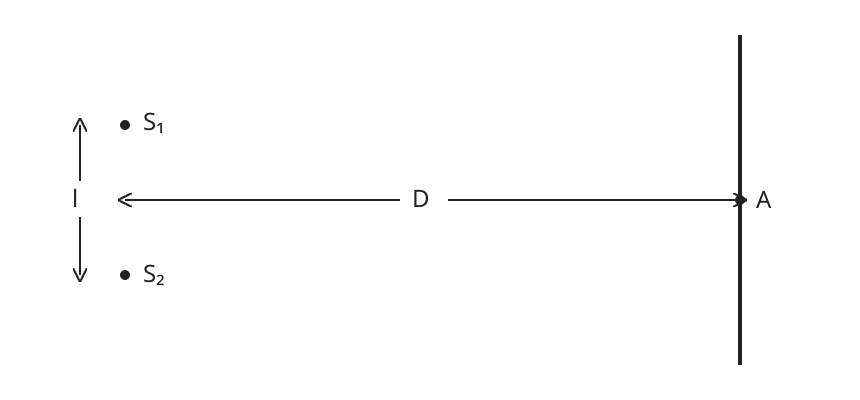
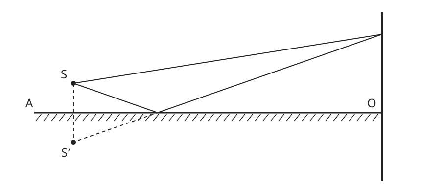

# P15/P16 — Two-source fringes and Lloyd's mirror

Source problems **764** and **766**, local selectors **P15** and **P16**.
[Classification](CLASSIFICATION.md) · [Pinned-library audit](PHYSLIB_AUDIT.md) ·
[Two source records](source.jsonl).

Some textbook problems depend on previous exercises. The original source
relationship is preserved in documentation, but the Lean problem specifications
are made semantically self-contained.

## Problem 764

### Original source problem — BEFORE

> Two coherent sources of light S₁ and S₂ are at a distance l from each other.
> A screen is placed at a distance D ≫ l from the sources (Fig. 253). Find the
> distance between adjacent interference bands near the middle of the screen
> (point A) if the sources send light with a wavelength λ.

### Original figure and new schematic

The actual user-provided `Screenshot from 2026-11-05 15-43-07.png` was opened
and identified as **Fig. 253**. It shows S₁ and S₂ with transverse separation l,
a distant vertical screen, the midpoint line ending at A, and horizontal
distance D. It does **not** show C, hₖ, d₁, d₂ or a fringe-ray construction.
The wavelength and D≫l regime are supplied by the problem prose.



### Supplied solution

At a point C on the screen, let the source paths be d₁ and d₂. Bright fringes
satisfy `d₂−d₁=kλ`. With hₖ the height above the midpoint A, the solution uses

```text
d₂² = D² + (hₖ+l/2)²
d₁² = D² + (hₖ−l/2)²
(d₂+d₁)(d₂−d₁) = d₂²−d₁² = 2hₖl.
```

It approximates `d₂+d₁≈2D` in the far-screen/near-center regime, obtains
`hₖ=kλD/l`, and subtracts consecutive bright orders to find

```text
Δh = λD/l.
```

These path labels and equations belong to the supplied solution and Candidate
derivation, not to the reconstructed original diagram.

### Lean-facing problem — AFTER

Given positive separation, screen distance and Physlib wavelength, find the
unique positive spacing whose integer phase-order positions and complete
bright-fringe lattice agree with the adopted paraxial two-source model.

`Problem764.lean` defines `IsFringeSpacing data spacing` by positivity, the
positions of successive **phase orders**, and all cosine-intensity maxima. It
asks `∃! spacing, IsFringeSpacing data spacing`. It contains no expected
`λD/l` result or Candidate import.

`Candidate764.lean` constructs `solutionSpacing = λD/l`. The visible proof chain
is exact coordinate ranges → difference of squares → factored path difference
→ explicit far-field closure → phase-order positions → all bright/dark centers
→ adjacent bright spacing → returned witness and uniqueness.

### Exact geometry and approximation boundary

Coordinates are S₁=(-D,l/2), S₂=(-D,−l/2), screen point=(0,h). This is a local
mathematical representation of the inspected source geometry; h is an introduced
coordinate, not an original figure label. `GeometryDerivation.lean` proves

```text
d₂²−d₁² = 2hl
(d₂+d₁)(d₂−d₁) = 2hl.
```

The actual Euclidean path difference is nonlinear. At the center the formal
proof shows **d₂+d₁>2D**, because l>0. There is no false finite-geometry equality.
The far-screen model is explicitly defined by replacing the denominator in
the difference-of-squares identity:

```text
δ_paraxial(h) := (d₂(h)²−d₁(h)²)/(2D).
```

Candidate derives `δ_paraxial(h)=lh/D`. Thus the adopted model is linear, and
its spacing formula is exact **inside that model**. This is a joint far-screen,
near-axis approximation, not the exact finite-separation Taylor derivative.
In particular the center ranges are `sqrt(D²+(l/2)²)`, not D.

No arbitrary numerical definition of “≫”, finite error bound, or exact statement
of accuracy for every positive D/l is invented. The source's regime selects the
approximation. Algebra extends it to all real h and integer orders; physical
claims are confined to the near-center regime in which it is appropriate.

Coherence means fixed relative phase, not necessarily zero relative phase. The
ordinary equal-initial-phase reference is the interpretation used by the supplied
solution's integer bright-order construction. It is explicit in `ordinaryPhase`;
it is not inferred from the word “coherent” alone.

### Candidate result and terminology

```text
bright centers: hₙ = n λD/l
dark centers:   hₙ = (n+1/2) λD/l
bright-to-bright spacing = dark-to-dark spacing = λD/l
bright-to-neighboring-dark distance = λD/(2l).
```

All are derived. Positive wavelength/separation/distance exclude degenerate
spacing and division by zero. Signed integer orders represent both sides of A.

## Problem 766

### Original source problem — BEFORE

> Lloyd's interference experiment consisted in obtaining on a screen a pattern
> from source S and from its virtual image S′ in mirror AO (Fig. 255). How will
> the interference pattern obtained from sources S and S′ differ from the
> pattern considered in Problem 764?

The final sentence is preserved literally in the source record. The textbook
dependency is part of the historical problem, not a missing Lean premise.

### Original figure and new schematic

The actual `Screenshot from 2026-11-05 15-43-52.png` was opened and identified
as **Fig. 255**. It shows a real S above horizontal mirror AO, virtual S′ below,
the screen at O, a direct ray, a reflected ray reaching the same unlabeled
screen point, and dashed virtual backward/perpendicular guides.



The drawn rays and dashed extensions are original-problem image information.
No phase annotation, solution formula, source-pair separation label or added
screen point C is introduced in this drawing. Pixel positions and the chosen
unlabeled ray-hit height are rendering choices, not measured source data.

### Supplied solution

Reflection in AO produces the coherent virtual source. The reflected wave gains
phase π, corresponding to a half-wave reversal. Consequently O, a maximum in
the ordinary reference pattern, becomes a minimum. The supplied solution says
the whole pattern is shifted by the width of a light (or dark) band.

### Lean-facing problem — AFTER

Two patterns are defined directly:

```text
ordinary phase(h) = 2π δ_paraxial(h)/λ
Lloyd phase(h)    = ordinary phase(h) + π.
```

Find a positive spatial phase-translation representative relating those two
functions, and verify how their maxima and minima correspond. The criterion
`IsRelativeShift` requires `LloydPhase(h)=ordinaryPhase(h+shift)` for all h and
positivity. It asks `∃! shift, IsRelativeShift data shift`, with no supplied
half-period answer or predetermined extrema relationship. Maxima/minima exchange
is a separately derived and checked Candidate theorem.

Uniqueness here uses the **unwrapped π phase branch**. Physical intensity
translations are periodic and hence not unique without a representative
convention; the theorem does not claim otherwise.

### Removing the previous-exercise dependency

`Problem766.lean` imports only shared geometry/optics. `Candidate766.lean` imports
its own problem and the shared solution-side geometry helper. Neither imports
`Problem764` or `Candidate764`; no `have := P15.solution` is used.

The comparison's wavelength, D and l are explicit positive **model parameters**.
For Lloyd geometry, l is the real/virtual source separation (twice the height
above the mirror), D the horizontal screen distance and h the coordinate from O.
Those letters are not attributed to the original Problem 766 prose or figure.
The ordinary comparison is represented explicitly, instead of retrieving the
answer to the previous exercise. The shared paraxial model is the quantitative
comparison regime, not an assertion that Problem 766 itself states D≫l.

### Phase reversal and the actual spatial shift

The reusable two-beam law uses positive arbitrary amplitudes a,b:

```text
I(θ) = a²+b²+2ab cos θ
maximum = (a+b)² when cos θ=1
minimum = (a−b)² when cos θ=−1.
```

The proof derives constructive phase `θ=2πn` and destructive phase
`θ=2π(n+1/2)`. Because `cos(θ+π)=−cos θ`, the maxima/minima interchange. Thus
ordinary h=0 is a maximum and Lloyd h=0 is a minimum as consequences, not source
evidence fields. A minimum need not be perfectly dark for unequal amplitudes.

Candidate independently obtains

```text
ordinary bright period P = λD/l
Lloyd maxima: h = (n+1/2)P
Lloyd minima: h = nP
shift = λD/(2l) = P/2.
```

The phase convention says `I_Lloyd(h)=I_ordinary(h+shift)`. Feature translation
may equivalently be described with the opposite sign, since +P/2 and −P/2 differ
by a full period. The invariant conclusion is the half-period offset and exchange
of extrema. A full bright-to-bright shift would reproduce the original pattern;
Verify rejects it as the answer to the unwrapped comparison criterion.

“One light (or dark) band width” is therefore interpreted as the conventional
alternating bright/dark-center step **P/2**, not the full bright-to-bright spacing
P. Continuous intensity has no intrinsically sharp band edges without a brightness
threshold convention; no such threshold is invented here. The mathematical
results specify centers and phase translations precisely.

Pi reversal is an explicit **supplied-solution optical assumption**. It is not
derived from the P11 geometric mirror-direction API, nor asserted for every
material, angle or interface. No Fresnel coefficients or electromagnetic boundary
problem is modeled. The virtual-source representation is given by the source
experiment. The constant spatial translation requires the adopted paraxial model;
the generic phase extrema swap does not require linear geometry. Apply the Lloyd
pattern only in the direct/reflected beam-overlap region. Finite mirror aperture,
intensity envelopes and grazing-ray availability at O are not solved; the center
minimum refers to the ideal comparison pattern/boundary limit.

## Direct-image workflow for both figures

```text
open the actual original problem image
→ inspect and identify its geometry directly
→ formalize source-visible relationships
→ redraw a new clean schematic from that image
```

Both filenames were opened before their figure numbers were assigned. Source
records preserve their identity and SHA-256. No trusted-caption intermediary,
copied scan, independently downloaded textbook or solution figure is used. The
[generator](generate_problem_diagrams.py) was authored from the direct visual
inspection and consumes no caption, solution text, Candidate or source pixels.
Its deterministic regeneration is a reproducibility check, not a machine proof
of visual fidelity. Source/model interpretation remains a multimodal/human audit.

## Shared API and dimensions

Stable Physlib's `Wavelength` and `WithDim` are reused. The new source-independent
[TwoBeamInterference](../../PhyslibTemp/Optics/TwoBeamInterference.lean) supplies
path-to-phase conversion, the adopted coherent intensity law, extrema/order
theorems and additive phase reversal. It has no screen geometry, paraxial law,
Lloyd-specific reflection assumption or fringe-spacing formula. See its
[design notes](../../PhyslibTemp/Optics/TwoBeamInterference.md) and independent
[examples](../../PhyslibTemp/Optics/TwoBeamInterferenceExamples.lean).

`Units.lean` executes typed products/divisions and scalar bridges:

```text
[λ]=[D]=[l]=L
[δ_paraxial]=L²/L=L
[λD/l]=L; [λD/(2l)]=L
[2πδ/λ]=1; [π reflection offset]=1.
```

The typed expressions reduce to the actual scalar Candidate spacing, shift,
path model and reusable phase. There are no source numerical conversions; all
parameters use coherent length coordinates. Dimensional correctness does not
prove the approximation or the optical reflection-phase assumption.

## Organization and verification

One directory contains separate `Problem764`/`Candidate764` and
`Problem766`/`Candidate766`, two annotated proofs, shared geometry/Units/Verify,
one README, and two source JSONL records. `verification.json` holds two independent
configurations. The runner accepts this list as well as every legacy single
configuration, preserving its four stages; Python tests cover both forms. The
existing single-selector evidence collector also recognizes paired records,
configured Lean filenames and the selected source JSONL record, preserving its
legacy checks without becoming a multi-problem scheduler.

Verify supplies positive consistency data, tests the computed spacing/shift,
rejects half a period as bright-to-bright spacing and a full period as Lloyd
shift, checks zero-path extrema and rejects the false exact finite range sum.
No final answer is stored in either trusted target. Mutation manifests are
explicitly empty/deferred, as for recent examples.

```bash
lake build
python3 scripts/verify.py P15
python3 scripts/verify.py P16
python3 scripts/test_verify_config.py
python3 LeanVerificationDemo/PhysicsDemo/P15P16/generate_problem_diagrams.py --check
lake env lean LeanVerificationDemo/PhysicsDemo/P15P16/Units.lean
lake env lean LeanVerificationDemo/PhysicsDemo/P15P16/PairingWalkthrough.lean
git diff --check
```

Validation: `lake build` passed (4005 jobs); M00 and P01–P16 all passed.
M00/P01/P02 passed six mutations each; P03–P16 explicitly skipped their deferred
empty manifests. Units, independent shared examples and PairingWalkthrough
compiled directly. Both Candidate and annotated final theorems use only
`[propext, Classical.choice, Quot.sound]`. Three Python config compatibility tests,
both SVG regeneration checks, rendered previews, source-image hashes, annotation
parity and `git diff --check` passed. No `sorry`, new axiom, native-evaluation
proof or floating-point physics calculation was introduced. P16's compiled
imports show its own Problem766 and GeometryDerivation, with no Candidate764.

The existing evidence collector also passed for selector P16 with paired metadata,
noncanonical Lean filenames and the selected source JSONL record. It collected
both Candidates' files without changing their mathematical import dependencies.
An independent read-only review found no Critical/Important/Minor changes needed;
this is a semantic review in addition to the technical checks, not a property
proved by the evidence collector itself.
